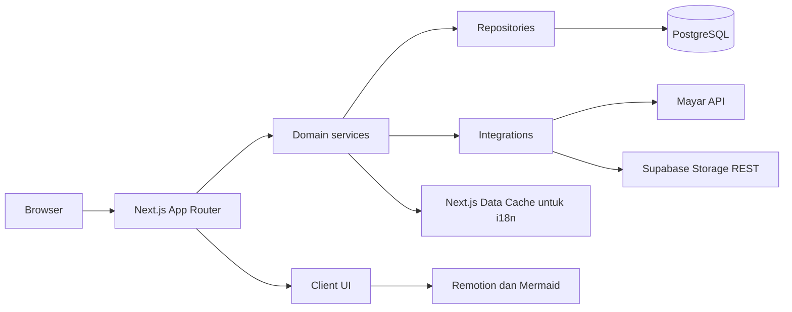
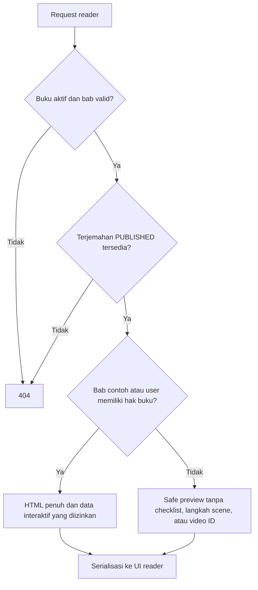
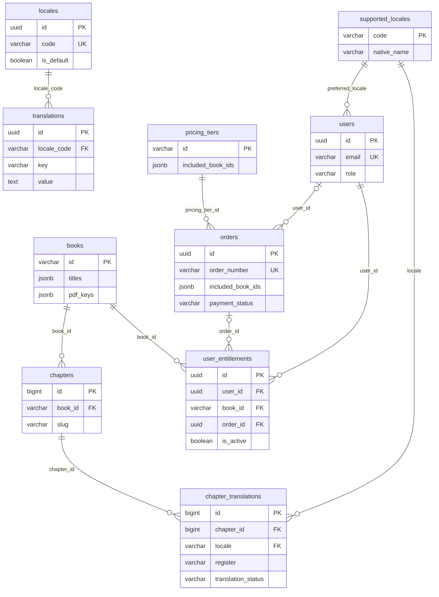

# Arsitektur aplikasi

[Indeks dokumentasi](README.md) · [Pembayaran](payments.md) · [Referensi API](api-reference.md)

## Komponen dan boundary

Page, Route Handler, dan Server Action menangani routing, decoding input, respons, serta presentasi. Service menerapkan aturan domain dan otorisasi; repository menjalankan query Drizzle/SQL. Integrasi membungkus SDK/vendor. [ESLint](../eslint.config.mjs) membatasi import DB, ORM, dan repository dari `app/` serta `components/`.

| Module | Tanggung jawab | Entry |
| --- | --- | --- |
| Auth | Credential, sesi/profil, role, dan rate limit | [auth.service.ts](../lib/modules/auth/auth.service.ts) |
| Books | Katalog, tier, library, dan administrasi metadata | [books.service.ts](../lib/modules/books/books.service.ts) |
| Orders | Checkout, invoice, callback, dan fulfillment | [orders.service.ts](../lib/modules/orders/orders.service.ts) |
| Reader | Konten terbit, pencarian, checklist, PDF, dan edit naskah | [reader.service.ts](../lib/modules/reader/reader.service.ts) |
| Entitlements | Kebijakan akses buku dan grant admin | [entitlements.service.ts](../lib/modules/reader/entitlements.service.ts) |
| i18n | Locale, dictionary, fallback, dan cache | [i18n.service.ts](../lib/modules/i18n/i18n.service.ts) |

Service memakai export fungsi/object. Input domain divalidasi melalui schema Zod di module masing-masing. Tidak ada worker antrean, scheduler rekonsiliasi, atau layanan embedding pada runtime saat ini.

## Autentikasi dan role

[Auth.js](../lib/integrations/auth.ts) mengaktifkan Credentials provider, bcrypt, dan sesi JWT dengan `maxAge` 30 hari. Saat token diperiksa kembali tanpa user login baru, callback mengambil profil/role dari database; akun yang sudah hilang kehilangan `token.id`.

| Role | Kemampuan yang diterapkan |
| --- | --- |
| `reader` | Koleksi dan progress milik sendiri; akses buku mengikuti entitlement aktif. |
| `editor` | Area admin, termasuk pengelolaan konten/locale/order dan grant buku; tidak dapat mengubah role user. |
| `admin` | Kemampuan editor ditambah perubahan role user. |

`requireAdmin()` menerima `admin` maupun `editor` dan mengarahkan user lain ke `/login`. Guard ada pada data fetching dan mutasi service/action; middleware locale tidak memutuskan otorisasi admin. Auth.js memiliki konfigurasi Drizzle adapter dan tabel pendukung, tetapi Google/OAuth dan reset password belum diaktifkan sebagai flow aplikasi.

## Pemeriksaan akses reader

Hak buku berasal dari entitlement aktif atau role pengelola. Server membentuk payload sebelum dikirim ke client. Bab contoh tidak membuat seluruh buku menjadi terbuka. HTML disanitasi kembali saat dibaca; metadata buku/daftar bab tetap dapat ditampilkan pada reader terkunci.

PDF selalu membutuhkan login, buku aktif, dan hak buku. Search hanya mengambil buku/locale aktif dan naskah PUBLISHED, serta menyembunyikan snippet paid dari user tanpa hak. Checklist pada bab contoh dapat ditoggle anonim, tetapi tanpa sesi perubahan tersebut tidak disimpan ke database.

## Model data inti

Diagram berikut menampilkan foreign key inti, bukan seluruh kolom atau tabel Auth.js.

- Unique `(user_id, book_id)` membatasi satu record entitlement per pasangan user/buku. `is_active` menentukan aksesnya.
- `included_book_ids` pada tier dan order berupa JSON, bukan relasi junction/FK per elemen. Grant ke buku yang tidak valid dapat menggagalkan transaksi fulfillment.
- `locales` dan `supported_locales` disinkronkan oleh repository i18n berdasarkan kode. Tidak ada foreign key antara kedua tabel tersebut.
- `checklist_progress` memiliki FK user/buku dan unique user/book/slug/item_id. `item_id` adalah 12 digit pertama SHA-256 atas label HTML tersanitasi (UTF-8), disimpan sebagai varchar(16); posisi bukan identitas. Label identik dalam bab berbagi completion, sedangkan label terjemahan berbeda memiliki ID berbeda. Keberadaan bab dan item diperiksa service, bukan FK ke chapter.
- `chapter_translations` memiliki search vector dan embedding `vector(768)`. Query pencarian saat ini memakai full-text dan `ILIKE` judul; belum memakai embedding.

Definisi lengkap tabel, constraint, dan indeks ada di [schema.ts](../lib/db/schema.ts). Berkas [migrasi](../drizzle) adalah riwayat DDL yang dijalankan ke database.
