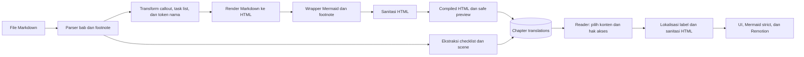

# Konten dan media

[Indeks dokumentasi](README.md) · [i18n](i18n.md) · [Pengujian](testing.md)

## Input naskah

`MANUSCRIPT_SOURCE_DIR` menentukan root input seed. Default script adalah `../crow.asia` relatif terhadap working directory project. Lokasi ini hanya sumber file; runtime reader mengambil hasil kompilasi dari PostgreSQL.

Daftar naskah di [seed-data.ts](../lib/content/seed-data.ts) menggunakan pola berikut untuk `book-1.md` sampai `book-3.md`:

```text
content/
└── books/
    ├── id/
    │   ├── casual/
    │   └── standar/
    └── en/
```

Nama folder `standar` adalah path input; nilai register yang disimpan adalah `standard`.

```bash
MANUSCRIPT_SOURCE_DIR=/path/to/content npm run db:seed
```

Script memeriksa keberadaan seluruh input sebelum mulai menulis. Kegagalan setelah proses penulisan dimulai dapat meninggalkan sebagian data terisi karena seluruh ingestion tidak dibungkus satu transaksi besar. Rerun memakai upsert, tetapi tetap perlu meninjau penyesuaian konten yang sudah ada.

## Pipeline konten



Parser memisahkan bab melalui heading `##`, melewati daftar isi, memberi slug `ch-N`, serta menyertakan definisi footnote global yang dibutuhkan. Bagian rujukan riset dapat digabung ke bab terakhir berdasarkan aturan parser.

Compiler mendukung Markdown, tabel, footnote, task list, callout, drawer skrip, dan diagram Mermaid. Sanitasi dilakukan setelah render/transform HTML. Safe preview mengambil tiga elemen paragraf/blockquote pertama jika tersedia; jalur fallback memakai teks hingga 300 karakter.

Task list diekstrak sebagai checklist dengan indeks tampilan dan ID berbasis hash label. Progress memakai ID, sehingga insert/reorder tidak memindahkan completion. Perubahan HTML label (termasuk format/link) menghasilkan ID baru; label identik dalam satu bab berbagi completion. Placeholder `[Nama]`, `[Nama Staf]`, `[Nama Anggota Tim]`, `[Teammate Name]`, dan `{{teammateName}}` mendukung personalisasi nama. Client memperbarui teks token; isi naskah tidak disimpan ulang saat nama diganti.

Rujukan: [parser](../lib/modules/reader/content/parser.ts), [compiler](../lib/modules/reader/content/compiler.ts), dan [renderer artikel](../components/modules/reader/PreCompiledArticle.tsx).

## Perilaku seed

| Data | Perilaku `db:seed` |
| --- | --- |
| Metadata locale | Menambah yang belum ada; konfigurasi locale existing dipertahankan. |
| Buku dan tier | Upsert metadata dari konstanta seed. |
| Chapter | Mencari/membuat berdasarkan buku dan slug; chapter baru memiliki sample untuk indeks 0 dan 1. |
| Ilustrasi | Menghubungkan `.webp` atau `.svg` yang ditemukan. |
| Terjemahan bab | Menulis ulang naskah, kompilasi, checklist, scene, dan status PUBLISHED. |
| Search vector | Memperbarui indeks teks dari judul dan raw Markdown. |

Seed naskah dapat mengganti edit admin dan mempublikasikan kembali naskah yang ada. Untuk pekerjaan editorial rutin, gunakan editor admin. Seed dictionary UI adalah script berbeda dan hanya menambahkan key yang belum ada.

## Pengelolaan editorial

| Halaman | Kegunaan |
| --- | --- |
| `/admin/books` | Metadata buku, judul/subjudul, harga satuan, dan PDF object key. |
| `/admin/chapters` | Indeks, slug, sample, ilustrasi, konfigurasi animasi, dan YouTube opsional. |
| `/admin/translations` | Dictionary UI dan editor manuskrip bab. |

Editor manuskrip menerima DRAFT, REVIEW, atau PUBLISHED. Status dapat dipilih langsung; belum ada workflow approval wajib antarroll. Penyimpanan mengunci row terjemahan, mengompilasi ulang konten, dan memperbarui search vector dalam transaksi. Reader/pencarian hanya mengambil terjemahan PUBLISHED. Form mengirim baseline `updated_at`; service memeriksanya setelah row dikunci dan menolak save usang dengan `ServiceError(409)`. Token selalu dimajukan minimal 1 ms. Form di-key berdasarkan ID dan revisi agar baseline tidak terpisah dari naskah; refresh yang membawa revisi baru mereset input (termasuk edit yang belum disimpan), sedangkan refresh revisi yang sama mempertahankan input. Muat ulang naskah sebelum menyimpan ulang; server action bukan endpoint JSON dan kegagalan dapat ditangani error boundary Next.js.

## Migrasi identitas checklist

Migration `0006_checklist_item_id.sql` harus dijalankan melalui migrator Drizzle (satu transaksi) saat penulisan reader/editor dihentikan. Ambil backup terlebih dahulu, jalankan migration, deploy server/client baru bersama, lalu minta tab reader lama dimuat ulang. API baru menolak `item_index`; jangan menjalankan app lama setelah migration.

Migration mengisi ID semua JSON checklist tersimpan, lalu memetakan progress lama ke setiap label pada posisi yang sama di terjemahan PUBLISHED saat migrasi. Jika beberapa posisi mempunyai label identik, timestamp progress terbaru dipertahankan (tie memakai ID row). Posisi tanpa padanan dibuang. Progress lama tidak mencatat bahasa atau teks historis, sehingga tidak mungkin menentukan tugas asli jika sudah pernah diurutkan ulang; kesamaan jumlah item bukan bukti kesamaan makna. Setelah cutover, completion untuk label bahasa/ragam yang berbeda bersifat terpisah. Uji migration di database `_test` sebelum production; tidak perlu menjalankan seed ulang.

## Ilustrasi, animasi, dan font

- Ilustrasi dicari pada `public/illustrations/[bookId]/[chapterSlug].webp` atau `.svg`.
- Player landscape memakai komposisi `ChapterInteractiveStory16x9Comp`, meneruskan durasi/fps dan scene. Metadata composition ID tersimpan, tetapi belum ada registry pemilih beberapa komposisi.
- YouTube hanya diteruskan bila bab dapat diakses dan video diaktifkan. DOM shield merupakan perilaku UI, bukan pengganti otorisasi konten.
- Font utama dari `public/fonts/crow` dimuat melalui [next/font/local](../lib/shared/fonts.ts). CSS subset yang ada menyediakan fallback glyph.

## PDF

Unggah PDF secara manual atau melalui tooling Storage yang dipilih ke bucket private. Simpan object path relatif bucket pada `books.pdf_keys.a5`; jangan menambahkan nama bucket dua kali bila object memang berada di root bucket.

Jika key `a5` kosong, integration mencoba `playbooks/[bookId]-a5.pdf` sebagai object path. Bucket default adalah `playbooks`, sehingga default path tersebut mencakup subfolder bernama `playbooks` di dalam bucket. Sebaiknya isi object key secara eksplisit sesuai file yang diunggah.

Download tidak membuat PDF dari Markdown dan belum menyediakan uploader admin. Setelah hak akses lolos, server meminta signed URL selama 900 detik. Lihat [API PDF](api-reference.md#download-pdf) untuk status respons dan batas penanganan error.
