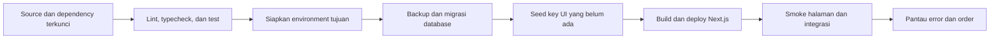

# Deployment dan operasional

[Indeks dokumentasi](README.md) · [Konfigurasi](configuration.md) · [Pembayaran](payments.md)

## Target deployment

Project memakai Next.js dengan konfigurasi region Vercel `sin1` pada [vercel.json](../vercel.json). Database runtime dapat menggunakan PostgreSQL yang dapat diakses dari deployment; koneksi localhost hanya berlaku untuk server yang berjalan pada mesin database tersebut.

Secret disimpan pada environment deployment, bukan pada repository. Atur nilai per environment agar preview/test tidak menggunakan database dan pembayaran production secara tidak sengaja.

## Alur rilis



Diagram adalah prosedur rilis yang disarankan. Repository belum menyediakan workflow CI/CD yang menjalankan seluruh tahapan tersebut secara otomatis.

### 1. Validasi source

```bash
npm ci
npm run lint
npm run typecheck
npm test
npm run db:check
```

Jalankan integration/browser test pada database terisolasi sesuai [pengujian](testing.md). `db:check` memeriksa berkas migrasi, bukan keberhasilan penerapan pada database tujuan.

### 2. Siapkan environment tujuan

| Area | Konfigurasi |
| --- | --- |
| PostgreSQL | `DATABASE_URL` runtime, `DIRECT_URL` untuk DDL, dan ekstensi `vector`. |
| Auth | `NEXTAUTH_SECRET`, `NEXTAUTH_URL`, serta `APP_URL` yang cocok dengan domain HTTPS. |
| Mayar | API key live, token callback, serta base URL bila berbeda dari default. |
| PDF | URL Supabase, service-role key server, bucket private, dan object key buku. |

Jika memakai pooler untuk runtime, pastikan budget koneksi memperhitungkan pool hingga lima koneksi per instance. User database runtime dan migrasi dapat dipisahkan sesuai kebijakan deployment.

`VERCEL_TOKEN` hanya dibutuhkan proses CLI/API yang menggunakannya. Mengisi token pada `.env.local` tidak otomatis menghubungkan Git atau menjalankan deployment.

### 3. Terapkan schema dan dictionary

Dengan environment database tujuan pada proses lokal/CI:

```bash
npm run db:migrate
npm run db:seed-translations
npm run db:smoke
```

Siapkan backup sebelum perubahan schema/data. Pada instalasi baru, jalankan seed katalog/naskah dengan sumber konten yang benar. Pada instalasi berisi edit editorial, jangan menjalankan `db:seed` tanpa meninjau data yang akan ditulis ulang.

`db:seed-users` khusus development. Project belum menyediakan command provisioning admin production yang terpisah; tetapkan proses pembuatan akun pengelola sebelum operasional admin dibutuhkan.

### 4. Build dan jalankan

Gunakan build command Vercel `npm run build`, atau jalankan server produksi lokal dengan URL/port yang konsisten:

```bash
APP_URL=http://localhost:4052 NEXTAUTH_URL=http://localhost:4052 npm run build
APP_URL=http://localhost:4052 NEXTAUTH_URL=http://localhost:4052 npm run start -- --port 4052
```

Contoh tersebut memakai database dan konfigurasi vendor yang sudah ada pada environment proses. Untuk smoke test terisolasi, berikan konfigurasi database test dan jangan memakai key pembayaran live. Jika menjalankan beberapa server/build, gunakan `NEXT_DIST_DIR` berbeda dan gunakan nilai yang sama pada pasangan build/start.

## Pemeriksaan setelah deploy

- Ingress login harus langsung ke Vercel dengan Cloudflare DNS only. Sebelum production, uji pada preview Vercel bahwa `x-vercel-forwarded-for` berisi satu IP, header palsu dari client ditimpa, dan percobaan mengganti `x-forwarded-for`/`cf-connecting-ip` tidak mengubah allowance. Pemeriksaan lokal tidak membuktikan perilaku edge tersebut.
- Jalankan migration `0007_rate_limit_expiry.sql` sebelum cutover limiter untuk menyediakan indeks cleanup. Periksa [batas login dan retensi](configuration.md#sumber-ip-dan-budget-login); jangan mengubah ke proxy Cloudflare tanpa evaluasi trust baru.
- Landing, login, dan bab contoh merespons sesuai data konten yang dipublikasikan.
- User yang tidak login diarahkan dari dashboard/admin ke login; PDF merespons 401.
- User yang login tanpa hak buku menerima 403 untuk PDF dan tidak menerima paid snippet/checklist/scene penuh.
- Callback token salah ditolak. Konfirmasi pembayaran menggunakan data uji vendor yang sesuai sebelum alur pembelian dibuka untuk pengguna.
- Callback berulang tidak menggandakan grant dan tidak mengaktifkan entitlement yang dicabut.
- Perubahan dictionary admin terlihat pada halaman publik setelah penyimpanan.
- Bucket PDF private dan signed URL mengarah ke object yang benar.

Mode mock payment tidak tersedia di production. Server production dengan key Mayar kosong/mock tidak dapat membuat invoice.

## Penanganan gangguan

| Gejala | Pemeriksaan awal |
| --- | --- |
| Koneksi DB gagal | Nilai `DATABASE_URL` efektif, host/port, hak user, dan prioritas environment shell terhadap file. |
| Migrasi gagal pada vector | Ekstensi tersedia dan user migrasi memiliki izin atau extension sudah disiapkan administrator. |
| Login tidak berhasil | Akun/password, role/profil, cookie, secret auth, URL, dan batas percobaan. |
| Mutasi 403 | Origin request dan `APP_URL`, kemudian hak domain bila route juga memeriksanya. |
| Checkout 502 | Konfigurasi key, konektivitas/vendor, dan status order; akun guest mungkin sudah tersimpan. |
| Callback 401/409 | Token/signature gateway dan konsistensi identifier order/invoice/transaksi. |
| PDF 503 | Service-role key, bucket, object key, serta respons Storage. Error transport tak terduga dapat menjadi 500. |
| Hasil search kosong pada locale baru | Search tidak memakai fallback naskah reader; cek terjemahan PUBLISHED untuk locale/register yang diminta. |
| Seed UI belum terlihat | Seed CLI tidak menginvalidasi cache Next yang berjalan; periksa revalidation atau lakukan rollout/restart sesuai prosedur. |

Log invoice gagal saat ini mencatat jenis error, bukan tracing terstruktur lintas request. Belum ada retry queue, alert otomatis, atau rekonsiliasi berkala; kebutuhan tersebut tercantum pada [rekomendasi](recommendations.md).

## Backup dan pemulihan

Simpan backup database dan object PDF melalui prosedur infrastruktur yang digunakan. Repository tidak menyediakan script backup/restore atau migrasi turun otomatis. Uji pemulihan pada environment terpisah, termasuk schema, naskah, dictionary, akun, order, entitlement, dan object key PDF.
