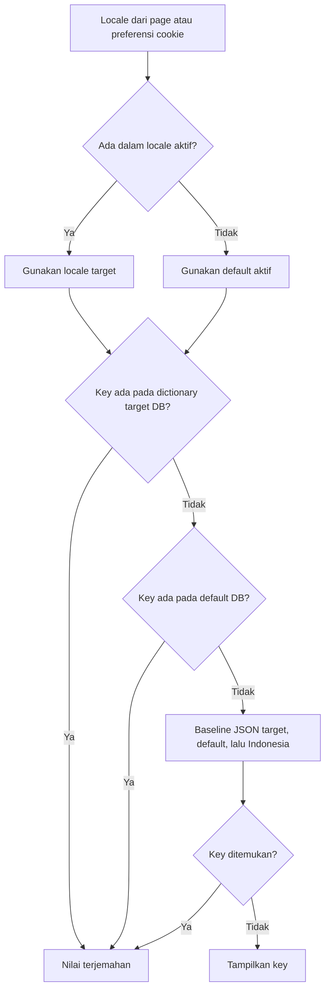
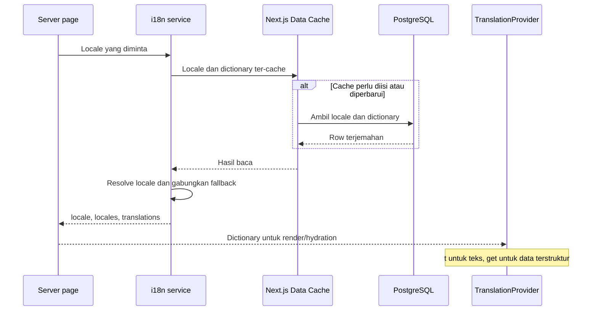

# Bahasa dan terjemahan

[Indeks dokumentasi](README.md) · [Konten](content.md) · [Konfigurasi](configuration.md)

## Jenis data bahasa

| Data | Sumber | Pengelolaan |
| --- | --- | --- |
| Teks UI | `translations`, fallback `lang-id.json`/`lang-en.json` | Editor dictionary di `/admin/translations`. |
| Naskah bab | `chapter_translations` per locale/register | Editor manuskrip pada halaman yang sama. |
| Metadata buku/tier | JSON pada `books` dan `pricing_tiers` | Form buku/tier di admin. |

Perubahan dictionary UI tidak menerjemahkan seluruh naskah atau metadata produk secara otomatis. Locale baru dapat diaktifkan sebelum naskah lengkap, tetapi tetap membutuhkan konten atau fallback yang sesuai untuk reader.

## Resolusi locale dan nilai

Halaman publik yang memakai `getRequestTranslations()` mendahulukan parameter locale yang diberikan page, lalu cookie `crow:locale`, kemudian bahasa default aktif. Reader menggunakan locale pada path; bila tidak diberikan, page menggunakan preferensi request. Bahasa tidak aktif/tidak dikenal diarahkan oleh service ke default aktif.



Implementasi menggabungkan baseline Indonesia, baseline default bila tersedia, dan baseline target bila tersedia; nilai default DB lalu target DB menimpa hasil gabungan. Dengan demikian prioritas per key adalah target DB → default DB → baseline target → baseline default → baseline Indonesia. Array diganti sebagai satu nilai, bukan digabung per indeks.

Jika pembacaan locale gagal atau tidak memiliki row, service menyediakan metadata baseline id/en. Kegagalan membaca dictionary ditangani sebagai dictionary DB kosong agar file baseline tetap dapat dipakai. Ini fallback i18n; halaman yang membutuhkan data bisnis DB lain tetap dapat gagal bila database seluruhnya tidak tersedia.

## Cache dan konsumsi UI



Cache memakai `unstable_cache`, tag `i18n`, dan revalidation 300 detik. Setelah write admin berhasil, service memanggil `revalidateTag('i18n')`; action juga merevalidasi halaman. TTL adalah konfigurasi revalidation, bukan SLA bahwa nilai pasti berubah tepat pada detik ke-300.

Client menggunakan `useTranslation()`: `t(key, replacements)` mengembalikan teks, `get(key)` menjaga tipe array/object, dan TClient menampilkan satu key. Placeholder teks mendukung `:name` serta `{name}`.

Menu bahasa menyimpan cookie dan menavigasi URL. Middleware meneruskan informasi locale ke root layout untuk `html[lang]`; middleware tidak mengambil keputusan akses admin.

## Editor locale

`/admin/locales` menyediakan tambah/ubah metadata, aktif/nonaktif, dan pemilihan default. Service menolak penonaktifan default. Partial unique index menjamin paling banyak satu row default, CHECK mewajibkan default aktif, dan transaksi/advisory lock menserialisasi perubahan melalui repository.

`locales` dan `supported_locales` memiliki fungsi berbeda: tabel pertama mendukung dictionary UI/default, tabel kedua menjadi metadata yang direferensikan user dan naskah. Repository menyimpan perubahan metadata keduanya bersama.

## Editor dictionary

Key memakai notasi bertitik, misalnya `landing.hero.title_prefix`, dengan grup `landing`. Editor mendukung pencarian key/nilai, filter locale/grup, dan 25 baris per halaman.

| Aturan | Implementasi |
| --- | --- |
| Key | Maksimal 255 karakter; segmen alfanumerik/underscore/hyphen. Segmen prototype terlarang ditolak. |
| Grup | Maksimal 64 karakter dan harus sama dengan segmen pertama key. |
| Nilai | Maksimal 100.000 karakter. |
| Struktur | `valueType=string` atau `json`; JSON harus berupa array dengan struktur yang sesuai baseline untuk key yang dikenal. |
| Konflik | Parent/child key yang bertabrakan ditolak. |
| Unik | Satu row untuk pasangan locale/key. |

Bulk upsert tersedia pada service dengan batas 1.000 item; belum ada UI import bulk atau endpoint REST khusus. Menghapus override mengaktifkan fallback kembali, sehingga teks belum tentu hilang dari layar.

## Seed dan fallback konten

```bash
npm run db:seed-translations
```

Seed dictionary berada dalam transaksi dan hanya menambahkan key yang belum ada. Nilai hasil edit admin dipertahankan. CLI tidak menginvalidasi cache instance Next yang sedang berjalan; jalankan ketika rollout/restart atau biarkan mekanisme revalidation memperbarui cache.

Reader mencari naskah PUBLISHED pada locale target, default, `id`, lalu `en`, terbatas pada locale aktif. Dalam satu locale, service memilih register yang diminta, lalu standard atau kandidat lain yang tersedia. Query pencarian berbeda: locale/register dipakai langsung tanpa fallback reader.

Lokalisasi runtime memperbarui label wrapper diagram/footnote/practice dan sejumlah label scene yang dibentuk compiler. Isi dialog/checklist dari naskah tetap konten editorial, bukan hasil terjemahan otomatis dictionary.

Rujukan: [service](../lib/modules/i18n/i18n.service.ts), [repository](../lib/modules/i18n/i18n.repository.ts), [schema](../lib/modules/i18n/i18n.schema.ts), [dictionary codec](../lib/modules/i18n/dictionary.ts), [provider](../components/TranslationProvider.tsx), dan [reader](../lib/modules/reader/reader.service.ts).
