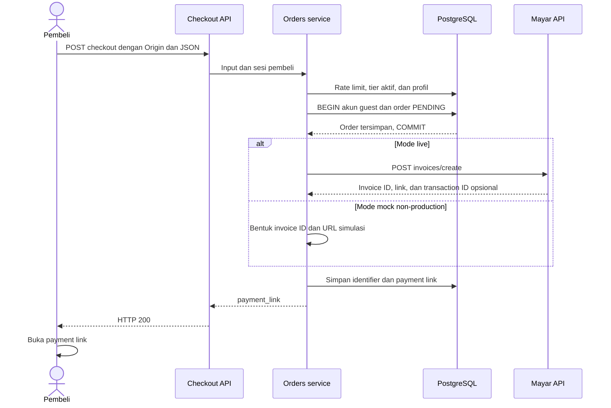
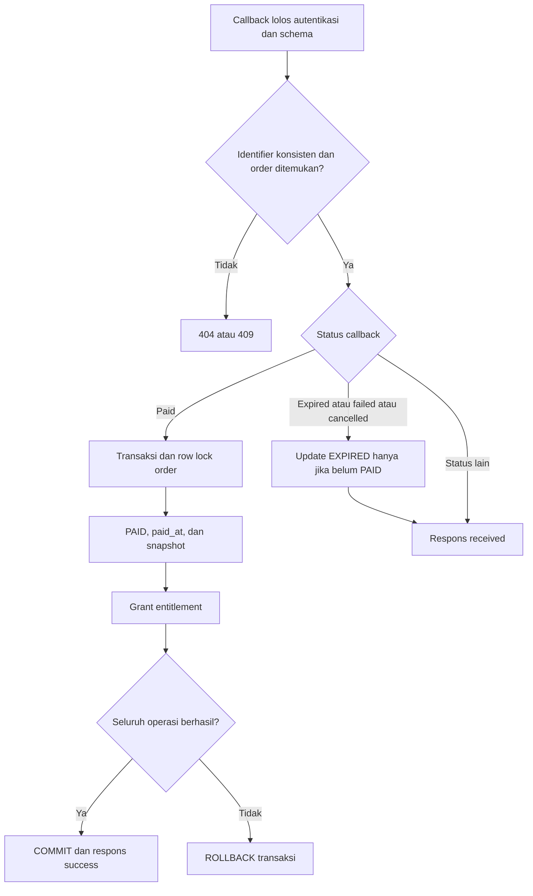
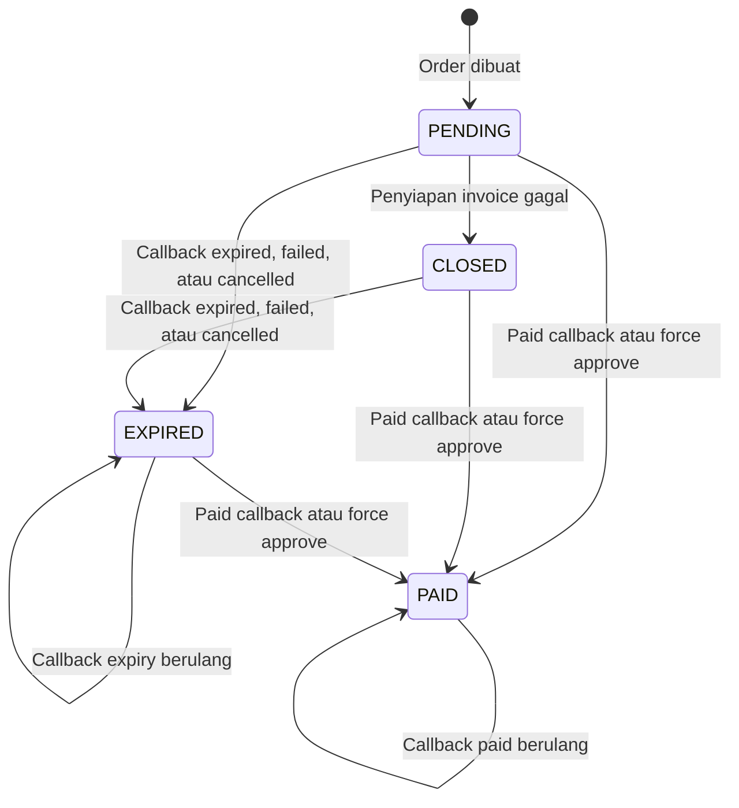

# Checkout dan pembayaran

[Indeks dokumentasi](README.md) · [Konfigurasi Mayar](configuration.md#mayar) · [Kontrak HTTP](api-reference.md#checkout)

## Pembelian dan invoice

Checkout menerima ID tier, email, nama opsional, nomor telepon, dan password untuk pembeli baru. Harga serta buku yang diperoleh ditentukan dari tier aktif di server. Order number dibentuk sebagai `CROW-YYYYMMDD-<12 karakter acak>` dengan tanggal UTC.

Request HTTP vendor tidak menahan transaksi akun/order. Pembuatan invoice memiliki timeout 15 detik dan respons divalidasi, termasuk URL HTTPS pada mode live.

Pembeli yang login menggunakan email profil akunnya sebagai email order, walaupun payload mengirim email lain. Guest dengan email yang sudah terdaftar harus login. Guest baru wajib membuat password; tidak ada flow registrasi umum yang terpisah dari checkout.

Order menyimpan `amount_idr` dan snapshot `included_book_ids`. Perubahan isi tier setelah pembelian tidak mengganti snapshot yang telah tersimpan. Harga USD digunakan untuk tampilan; invoice yang dibuat memakai `amount_idr`.

## Kegagalan invoice

Jika request Mayar atau penyimpanan hasil invoice gagal, service mencoba mengubah order yang masih PENDING menjadi CLOSED dan mengembalikan 502. Kondisi SQL tidak menutup order yang sudah PAID. Akun guest dan order yang telah di-commit tetap ada; user tersebut perlu login untuk checkout berikutnya.

Tidak ada retry otomatis, idempotency key keluar ke vendor, atau job rekonsiliasi invoice. Gunakan [rencana rekonsiliasi](recommendations.md#keandalan-pembayaran) sebagai pekerjaan lanjutan, bukan asumsi perilaku saat ini.

## Autentikasi callback

Endpoint: `POST /api/webhooks/mayar`.

1. Header `x-callback-token` harus cocok dengan `MAYAR_WEBHOOK_TOKEN`; nilai kosong ditolak. Implementasi membandingkan digest token dengan `timingSafeEqual`.
2. Body dibaca sebagai teks dan ditolak jika melebihi 1.000.000 byte UTF-8.
3. Jika `MAYAR_WEBHOOK_SIGNING_SECRET` terisi, header `x-webhook-signature` juga wajib valid.
4. JSON diparse dan divalidasi sebelum service mencari order.

Kontrak HMAC opsional adalah `sha256=<hex HMAC-SHA256 body>` dengan secret yang sama pada gateway dan aplikasi. Signing ini ditujukan untuk sender/gateway yang memang mendukungnya; bukan deklarasi bahwa callback langsung Mayar memiliki header tersebut. Token callback tetap diperlukan ketika HMAC aktif.

## Korelasi dan fulfillment

Service menerima alias order number `orderNumber`, `orderId`, `externalId`, atau `extraData.orderNumber`. Jika beberapa alias hadir, nilainya harus sama. Invoice diambil dari `invoiceId` atau `id`; `transactionId` juga dapat dipakai untuk pencarian. `productId` hanya menjadi lookup cadangan jika tidak ada kandidat dan tidak ada invoice identifier eksplisit.

Candidate order yang bertentangan, invoice yang tidak cocok, dan transaction ID yang berubah ditolak dengan 409. Field provider tambahan diperbolehkan oleh schema; daftar field yang dipakai tersedia di [orders.schema.ts](../lib/modules/orders/orders.schema.ts).

Status dibaca dari `data.status` jika ada, selain itu dari `event`, lalu diubah menjadi uppercase:

| Kelompok | Nilai yang ditangani |
| --- | --- |
| Paid | `PAID`, `SETTLED`, `SUCCESS`, `PAYMENT.RECEIVED`, `PAYMENT_SUCCESS` |
| Expired | `EXPIRED`, `FAILED`, `CANCELLED` |
| Lainnya | Diterima tanpa perubahan status order. |

`markOrderPaid()` menggunakan transaksi dan `FOR UPDATE`. Perubahan status dan grant di-commit bersama. Callback duplikat tidak menggandakan entitlement; grant yang hilang dapat dibuat kembali, tetapi entitlement yang telah dicabut tidak diaktifkan ulang oleh replay. Pembayaran order baru dapat mengaktifkan kembali hak buku.

## Status order

CLOSED dan EXPIRED tidak dianggap terminal permanen oleh service: konfirmasi paid yang sah atau force approve masih dapat melunasinya. Expiry tidak dapat menurunkan PAID. Refund dan pencabutan entitlement otomatis berdasarkan refund belum diimplementasikan.

## Administrasi dan simulasi

`/admin/orders` menampilkan maksimal 100 order, dengan filter status sebelum limit. Role pengelola dapat memakai Force Approve, yang memanggil fulfillment server yang sama dengan callback.

`/checkout/mock-pay/[orderNumber]` tersedia hanya ketika `isMockMode()` aktif. Page dan Server Action memeriksa mode tersebut; route tidak tersedia di production. Simulasi tidak otomatis membuat pembeli login, sehingga guest diarahkan ke login saat membuka dashboard.

Rujukan: [orders service](../lib/modules/orders/orders.service.ts), [repository](../lib/modules/orders/orders.repository.ts), [Mayar integration](../lib/integrations/mayar.ts), [verifikasi callback](../lib/integrations/mayar-webhook.ts), dan [grant repository](../lib/modules/reader/entitlements.repository.ts).
